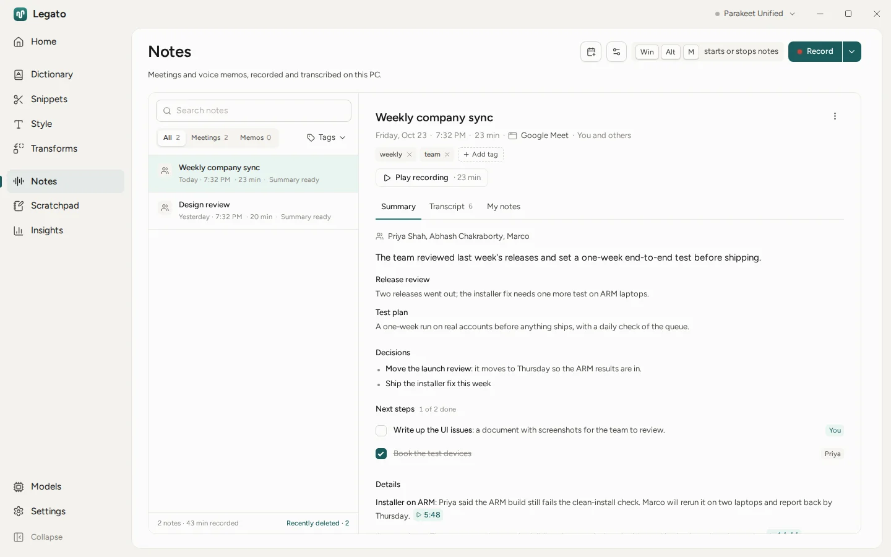
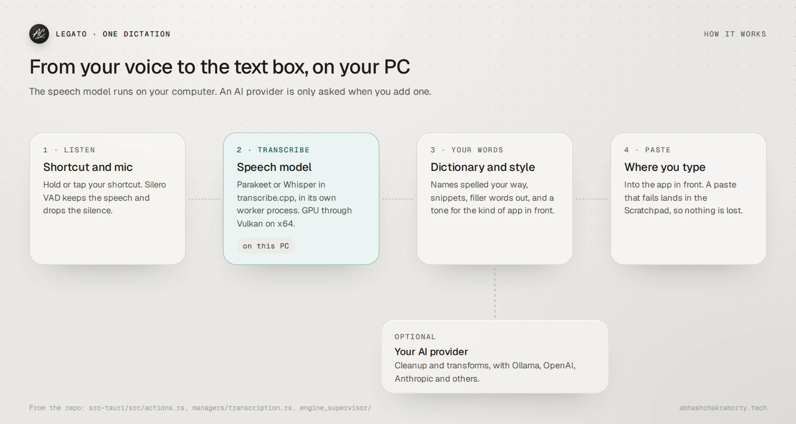

<p align="center"></p>

<h1 align="center">Legato</h1>

<p align="center">
  <b>Dictation and meeting notes for Windows, transcribed on your PC.</b><br>
  Hold a shortcut, speak, and the text lands where you're typing.<br>
  Record a meeting and get a transcript with each voice told apart.
</p>

<p align="center">
  <a href="https://github.com/Abhash-Chakraborty/legato/releases/latest"><picture><source media="(prefers-color-scheme: dark)" srcset="https://shieldcn.dev/github/release/Abhash-Chakraborty/legato.svg?variant=secondary&mode=dark"></picture></a>
  <a href="#install"><picture><source media="(prefers-color-scheme: dark)" srcset="https://shieldcn.dev/badge/Windows-x64%20%C2%B7%20ARM64.svg?variant=secondary&mode=dark"></picture></a>
  <a href="LICENSE"><picture><source media="(prefers-color-scheme: dark)" srcset="https://shieldcn.dev/github/license/Abhash-Chakraborty/legato.svg?variant=secondary&mode=dark"></picture></a>
</p>

<p align="center">
  <a href="https://github.com/Abhash-Chakraborty/legato/releases/latest">Download</a> ·
  <a href="#install">Install</a> ·
  <a href="#what-it-does">What it does</a> ·
  <a href="#how-it-works">How it works</a> ·
  <a href="docs/troubleshooting.md">Troubleshooting</a>
</p>

<picture>
  <source media="(prefers-color-scheme: dark)" srcset="docs/hero-dark.webp">
  
</picture>

Legato is a dictation app and meeting notetaker for Windows. Speech recognition runs on your computer with models such as Parakeet and Whisper, on the GPU through Vulkan on x64, so what you say stays on the PC. Summaries, transforms and Ask use an AI provider only if you add one yourself.

It started as a fork of [Handy](https://github.com/cjpais/Handy) by CJ Pais and its contributors (MIT). Notes, the Dictionary, the Scratchpad, the island and the bubble, phone sync and first-run setup were built in this fork.

## What it does

- **Dictation in any app.** Hold or tap a shortcut, speak, and the text is pasted where you're typing. Filler words go, numbers and lists are tidied, and the tone follows the kind of app in front. Say "press enter" to send, once you turn it on.
- **Your words.** The Dictionary keeps names spelled your way, learns from the words you fix, and snippets turn a phrase into saved text.
- **Meeting notes.** Record a call (one app's sound or everything) or a voice memo with a live transcript. Voices are told apart and recognised in later meetings. With a provider, summaries have decisions, next steps with owners and moments you can play back, and you can ask across all your notes.
- **Transforms and Ask.** Rewrite the selection or your last dictation with Ollama, OpenAI, Anthropic, OpenRouter, Groq or another provider.
- **Out of the way.** A bar, an island at the top of the screen or a bubble at the edge shows Legato is listening. It steps aside for fullscreen apps and stays out of screenshots and screen shares.
- **No accounts.** Word copies of notes for Google Docs or OneDrive, calendars from secret iCal addresses, follow-ups that open your calendar filled in. Legato never signs in anywhere.
- **More.** A Scratchpad for drafts and failed pastes, Insights on your dictation, MCP for AI apps (`legato --mcp`), questions from [Inyon](https://github.com/Abhash-Chakraborty/inyon)'s coding agents on the bar, and an Android app in development that syncs over Wi-Fi or Bluetooth ([how](docs/phone-sync.md)).

## How it works

<picture>
  
</picture>

A shortcut starts the microphone, and Silero VAD keeps only the speech. transcribe.cpp runs the speech model in a worker process, so a crash in the GPU driver can't take the app down, and a dictation that ends while the model is still loading onto the GPU is transcribed on the CPU meanwhile. The text then goes through your Dictionary, snippets and cleanup, and is pasted with the keys that suit the app in front.

## Install

Download `Legato_<version>_x64-setup.exe` (or `arm64` for Windows on Arm) from the [latest release](https://github.com/Abhash-Chakraborty/legato/releases/latest) and run it. It installs for your account and needs no administrator rights. Setup checks your microphone, picks a speech model for your languages and downloads it (0.5 to 1.6 GB). Legato updates itself after that.

The installers aren't code-signed yet, so SmartScreen may say "Windows protected your PC": choose More info, then Run anyway. You can [verify a download](docs/verify.md) against the release signature first.

To use Legato in apps run as administrator, install the `.msi` instead (for all users), then turn on Settings › General › Work in apps run as administrator.

Uninstalling keeps your data unless you tick "Delete app data". Downloaded models stay in the shared Hugging Face cache (`%USERPROFILE%\.cache\huggingface`), since other tools may use them.

## Build from source

You need Rust (stable), [Bun](https://bun.sh/), and on Windows the Visual Studio C++ tools, CMake and the Vulkan SDK ([BUILD.md](BUILD.md) has the details).

```powershell
bun install
bun run tauri dev      # run it
bun run tauri build    # installers in src-tauri/target/release/bundle
```

Built with Tauri 2 (Rust and React), transcribe.cpp on GGML, Silero VAD and SQLite. The command-line flags and debug mode are in [docs/cli.md](docs/cli.md).

## Status

Legato is in development and used daily on Windows 11. What to know:

- Windows only, on x64 and ARM64. ARM64 builds run the speech model on the CPU.
- The installers aren't code-signed yet.
- The Android app is in development and not released.
- Hiding from screen capture needs Windows 10 version 2004 or later.

Something not working? See [Troubleshooting](docs/troubleshooting.md) or [open an issue](https://github.com/Abhash-Chakraborty/legato/issues/new/choose).

## Credits

- [Handy](https://github.com/cjpais/Handy) by CJ Pais and its contributors, which Legato grew from. Legato is an independent fork and isn't affiliated with or endorsed by the Handy project.
- [transcribe.cpp](https://github.com/handy-computer/transcribe.cpp) and [GGML](https://github.com/ggml-org/ggml) for running speech models locally, and the Whisper, Parakeet and Silero VAD models.
- [Tauri](https://tauri.app) for the app framework.

## License

MIT. See [LICENSE](LICENSE).
